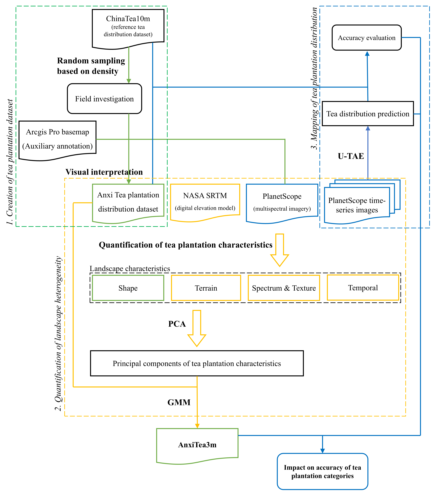
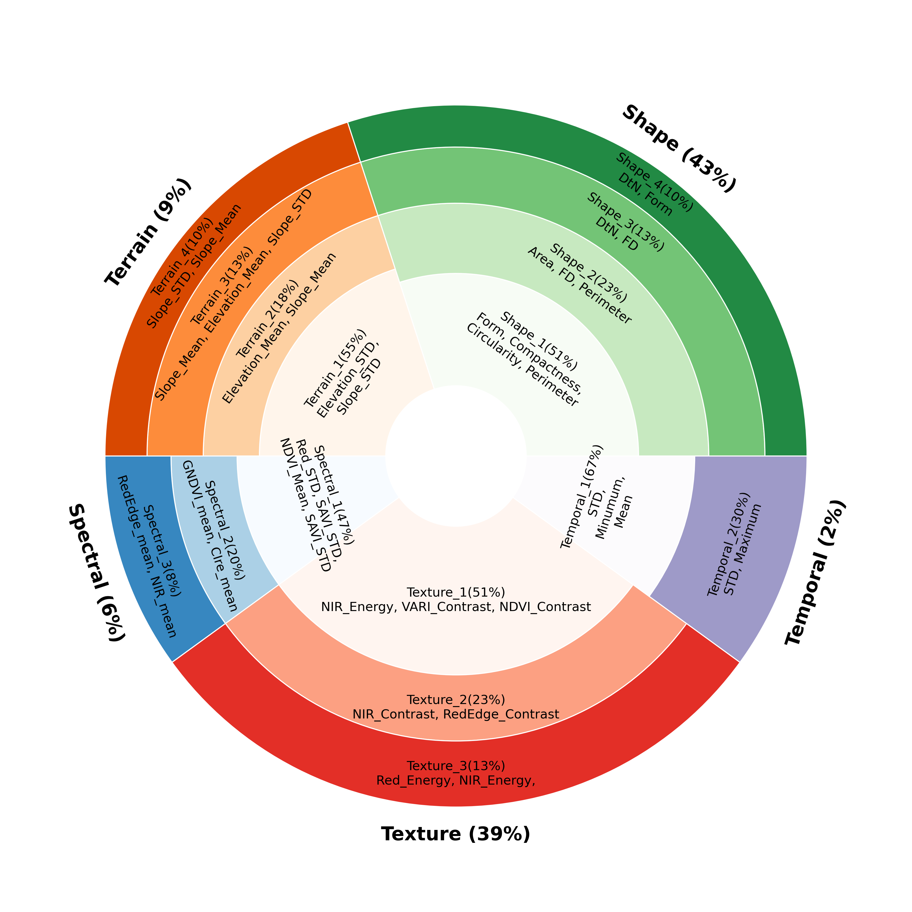
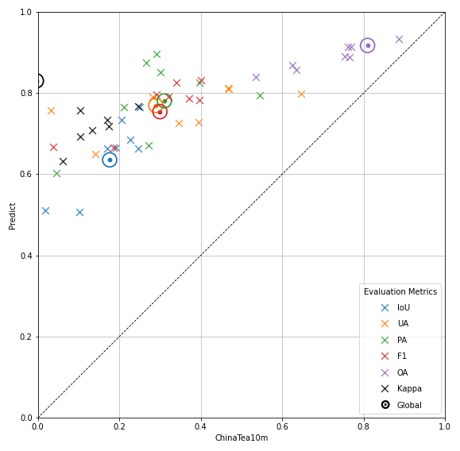

# AnxiTea3m

*A 3 m tea plantation reference dataset and landscape heterogeneity study in Anxi County, China*

**Interpretable Tea Plantation Mapping based on Landscape Heterogeneity Quantification and Deep Learning**

Zhichong Yang<sup>a,*</sup>, Mariana Belgiu<sup>a</sup>, Mengmeng Li<sup>b</sup>, and Alfred Stein<sup>a</sup>

<sup>a</sup> Department of Earth Observation Science, Faculty of Geo-Information Science and Earth Observation, University of Twente, the Netherlands.

<sup>b</sup> Key Lab of Spatial Data Mining & Information Sharing of Ministry of Education, Academy of Digital China (Fujian), Fuzhou University, Fuzhou 350108, China.

<sup>*</sup> Corresponding author: Zhichong Yang.

## Contents

1. [Overview](#overview)
2. [Study area and datasets](#study-area-and-datasets)
3. [Research workflow](#research-workflow)
4. [AnxiTea3m dataset construction](#anxitea3m-dataset-construction)
5. [Landscape heterogeneity characterization](#landscape-heterogeneity-characterization)
6. [Mapping performance and scientific findings](#mapping-performance-and-scientific-findings)
7. [Repository structure](#repository-structure)
8. [Acknowledgements](#acknowledgements)
9. [Citation](#citation)

## Overview

Tea plantations in mountainous regions differ in size, shape, canopy texture, terrain, and surrounding land cover. Treating tea as one homogeneous class can obscure the conditions under which a mapping model succeeds or fails. In particular, an aggregate accuracy score may conceal difficulties with small, fragmented parcels embedded within forests or near settlements.

The study addresses three linked objectives: construct a high-resolution tea plantation reference dataset; quantify parcel-level heterogeneity using shape, terrain, spectral, texture, and temporal characteristics; and examine how U-TAE mapping performance and predicted tea probabilities vary among the resulting landscape categories.

The contribution is a reference resource and an analytical framework for interpreting mapping outcomes. Landscape clustering and SHAP analysis support characterization and evaluation. They do not train U-TAE or modify its architecture or loss. The manuscript discusses soft landscape supervision and targeted model improvement as future directions.

## Study area and datasets

Anxi County covers **3,057.28 km²**, between **117°34′–118°18′ E** and **24°51′–25°26′ N**. Its mountainous terrain generally decreases in elevation from northwest to southeast. The county has a subtropical monsoon climate and is associated with Oolong and Tieguanyin tea production. These geographic descriptions follow manuscript Section 2.1.

| Resource | Verified study use | Availability in this repository |
|---|---|---|
| PlanetScope SuperDove | Orthorectified eight-band Surface Reflectance product; visual interpretation, time-series mapping, and landscape features | Source imagery is not distributed; the manuscript identifies licensing restrictions |
| ArcGIS Pro Images Basemap | Ancillary interpretation reference, with imagery up to 0.5 m; integrates Esri, Maxar, Earthstar Geographics, and GIS User Community imagery | Not distributed |
| NASA SRTM DEM | Accessed through Google Earth Engine; resampled to 3 m for alignment; elevation and slope for terrain characterization | Not distributed; native DEM resolution and exact asset identifier are not specified in the manuscript |
| AnxiTea3m | Field-supported reference polygons and landscape cluster attributes | [Original ZIP archive](./AnxiTea3m.zip) |
| ChinaTea10m | Sentinel-1/2-based external tea product used for field-point selection and comparative assessment | Not distributed |
| U-TAE predictions | Binary mapping outputs and predicted tea probabilities used in evaluation | Not yet released |

The manuscript describes PlanetScope's spatial resolution as **3.4 m**, while referring to the study dataset and analysis at **3 m**. These descriptions are retained as distinct acquisition and study-grid statements; the exact image resampling procedure is not supplied.

**Acquisition dates:** 14 January, 11 February, 14 May, 5 August, 10 September, 13 October, 27 November, and 31 December **2024**. These are eight observations across the year, not an uninterrupted monthly January–August series. The source product contains coastal blue, blue, green I, green, yellow, red, red-edge, and near-infrared bands.

Scenes with less than **1% cloud cover** were considered. Planet supplied radiometric and atmospheric corrections. Cloud- and shadow-contaminated pixels were identified with the **UDM2 quality mask** and replaced by linear interpolation between the nearest temporally adjacent valid observations (Section 2.2).

Manuscript Figures 1 and 3 provide the study-area map and annotation examples. They are withheld from this public repository pending review of the embedded basemap and satellite imagery rights; see the [figure index](./docs/figure_index.md).

## Research workflow



**Figure 2.** Description of the methodological approach proposed in our study. Data, methods and results are color-coded to distinguish different sections of the workflow, with green representing dataset creation, orange indicating heterogeneity quantification, and blue denoting the mapping of TP.

The reference-construction stage links density-guided field investigations to visual interpretation. Parcel features undergo group-specific PCA and GMM clustering, with SHAP used to interpret feature contributions. A separate U-TAE branch maps tea from PlanetScope time series. Predictions, reference polygons, landscape categories, and ChinaTea10m are brought together for evaluation. SRTM supports terrain characterization; decoder-level DEM fusion is not documented in the manuscript.

## AnxiTea3m dataset construction

### Field investigation and reference annotation

ChinaTea10m guided density-weighted sampling of **50 field investigation points**. Gaussian-smoothed density maps used plantation-area quartiles of **0.25, 0.5, and 0.75** to set smoothing scales, following the square-root-of-area approach described in Section 3.1. Normalized maps were overlaid to form the sampling reference. Each point defined a **1024 × 1024 pixel annotation region**.

Field investigations took place on **11–15 August 2024**. PlanetScope imagery provided the primary visual interpretation source, supported by field observations and the ArcGIS Pro Images Basemap where tea was difficult to distinguish. The acknowledgements identify expert guidance and assistance with interpretation and fieldwork. The detailed survey protocol is referenced as Supplementary Material S1, which is not supplied here; a complete annotation criterion checklist and formal quality-control procedure cannot be reconstructed from the main manuscript alone.

To connect fragmented patches, the manuscript describes **3-pixel dilation**, raster-to-vector conversion, and **3-pixel erosion** to restore the area. The resulting reference dataset contains **2,645 polygons**. The released archive supplies these polygon geometries and a `Cluster` attribute; it does not supply the original annotation rasters, region boundaries, or partition assignments.

### Geographic partitioning

The centroids of the 50 annotation regions were grouped into **five geographic strata using k-means**, with **random seed 42**. The procedure generated **10,000 candidate partitions** under a fixed **3:1:1 train/validation/test regional allocation**. Candidate scores equally weighted deviations in polygon counts and geographic-stratum composition from the target ratio; the lowest-deviation partition was selected.

| Partition | Regions under the fixed ratio | Tea polygons | Share reported in the manuscript |
|---|---:|---:|---:|
| Training | 30 | 1,586 | 59.9% |
| Validation | 10 | 545 | 20.6% |
| Testing | 10 | 514 | 19.4% |
| Total | 50 | 2,645 | 99.9% after rounding |

The regional counts follow directly from the fixed ratio and 50 regions. Images were then cropped to **128 × 128 pixel patches**, with each patch inheriting its region's assignment. Patches were not randomly split independently. This provides geographic organization without establishing complete statistical independence. Section 3.4 does not unambiguously identify the population used for the reported final metrics; this is recorded in the [evaluation review](./docs/reproducibility/source_review.md#evaluation-population-and-metrics).

## Landscape heterogeneity characterization

The complete standardized GMM input matrix served as the SHAP background, and the same observations were explained through the **GMM posterior-probability output**. For each cluster, mean absolute SHAP values were calculated for retained PCs across plantations, then aggregated by feature family (Section 3.2.2).



**Figure 5.** Feature-family contributions are scaled by SHAP importance in GMM clustering. Concentric rings show group-specific PCA components ordered by explained variance, with influential original variables identified from PCA loadings. This caption is condensed from the manuscript; the [figure index](./docs/figure_index.md#figure-5) retains the full caption.

Figure 5 reports contributions of **43% for shape**, **39% for texture**, **9% for terrain**, **6% for spectral**, and **2% for temporal characteristics**. Shape and texture together contribute **82%**. The displayed rounded group percentages sum to 99%; they have not been renormalized. These are clustering-attribution summaries, not causal effects or contributions to U-TAE accuracy.

## Mapping performance and scientific findings

### Overall mapping performance

The following are manuscript-reported values. An unresolved UA discrepancy is shown explicitly, and the evaluation population and metric aggregation require clarification before these values are treated as a reproducible benchmark.

| Metric | Reported value |
|---|---|
| Overall accuracy (OA) | 0.92 |
| Cohen's kappa | 0.83 |
| F1-score | 0.75 |
| Intersection over Union (IoU) | 0.64 |
| User's accuracy (UA) | 0.76 |
| Producer's accuracy (PA) | 0.78 |



**Figure 7.** Accuracy comparison between prediction and ChinaTea10m. Each point corresponds to a comparison region, and colored by metrics. Global evaluation for each metric is indicated by larger circular markers. The dashed black line represents the 1:1 agreement line between predicted and ChinaTea10m.

The manuscript reports better mapping performance than ChinaTea10m. As Section 5.1 emphasizes, this is a **product comparison**, combining differences in imagery resolution and processing; it does not isolate a U-TAE model effect. The stated metric improvements include an unresolved kappa difference, so no derived ChinaTea10m benchmark table is supplied here. Figure 7 is reproduced without alteration at its original resolution.

### Prediction probabilities across landscape categories

**Mean predicted tea probability within reference tea polygons** summarizes mapping outputs inside known tea parcels. Table 5 calls this quantity “Confidence.” It is distinct from classification accuracy, precision, recall, and GMM membership probability. The precise polygon, pixel, and comparison-region averaging convention is not fully specified in the manuscript.

| Manuscript category | Landscape description | Manuscript polygon count | Mean predicted tea probability within reference tea polygons |
|---|---|---:|---:|
| 1 | Dark-green plantations | 192 | 0.463 |
| 2 | Fragmented green plantations | 127 | 0.282 |
| 3 | Forest-embedded plantations | 501 | 0.443 |
| 4 | Small forest-embedded plantations | 527 | 0.473 |
| 5 | Large-scale plantations | 25 | 0.871 |
| 6 | Light-green plantations | 444 | 0.547 |
| 7 | Plantations near roadsides and villages | 93 | 0.549 |
| 8 | Large-scale, irregular plantations | 301 | 0.716 |
| 9 | Plantations with a bare-soil appearance | 432 | 0.590 |
| 10 | Plantations distinguished by temporal characteristics | 3 | 0.284 |

Counts and probabilities are transcribed from Table 5; descriptions follow Sections 4.1–4.3 and the Figure 8 legend. **The archive uses cluster codes 0–9, and two counts differ from the manuscript's categories 1–10.** The [dataset guide](./docs/dataset_description.md#cluster-codes-and-manuscript-counts) records both versions without changing the data or assuming a verified crosswalk. The probability values above must not be joined to archive records solely by adding one to `Cluster` without resolving that discrepancy.

Larger plantations with consistent canopy texture have higher reported tea probabilities, particularly category 5. Small, fragmented and forest-embedded parcels have lower values, illustrating why strong overall mapping scores do not characterize every landscape equally. Section 4.3 also reports confusion with forests, overestimation in some areas, and difficulties delineating small plantations. No additional cluster-specific precision, F1, or object-level IoU values have been inferred from these probability summaries.

### Interpretation and limitations

Shape and texture dominate the landscape characterization, while temporal variation has comparatively low aggregate attribution within this single-year, regional study. GMM groups reflect similarity in measured features and can overlap or differ from field-based management categories; membership probabilities do not guarantee internally uniform categories.

The manuscript identifies the absence of SWIR bands, reliance on one year of imagery, substantial training-label requirements, and incomplete representation of plantation management as limitations. Cross-regional transfer and inter-annual robustness were not demonstrated. Landscape-specific sampling, targeted validation, and soft landscape supervision are proposed research directions, not completed improvements to the released model.

## Dataset download and availability

[**Download AnxiTea3m**](./AnxiTea3m.zip)

The original archive contains an **ESRI polygon shapefile with 2,645 records**, a numeric `Cluster` field with values **0–9**, and its associated files. The `.prj` declares **WGS 1984 / UTM zone 50N**, with coordinates in metres; `.cpg` declares **UTF-8**. This is a vector reference dataset, not a PlanetScope image archive or prediction raster.

| Archive property | Verified value |
|---|---|
| Filename | `AnxiTea3m.zip` |
| Size | 23,974,808 bytes |
| Entries | `.shp`, `.shx`, `.dbf`, `.prj`, `.cpg`, `.sbn`, `.sbx`, and `.shp.xml`, all named `AnxiTea3m` |
| SHA-256 | `0aef0f2c63b1b04749c11211d9363007cd6a583aec7549a114cce07ea0695528` |

## Repository structure

```text
AnxiTea3m/
├── README.md
├── AnxiTea3m.zip
├── data/
│   ├── planetscope/
│   ├── dem/
│   ├── reference_annotations/
│   └── comparison_products/
├── dataset_construction/
│   ├── field_survey/
│   ├── visual_interpretation/
│   ├── quality_control/
│   └── spatial_splitting/
├── mapping/
│   ├── preprocessing/
│   ├── utae/
│   ├── training/
│   └── inference/
├── landscape_heterogeneity/
│   ├── feature_extraction/
│   ├── pca/
│   ├── gmm/
│   └── shap/
├── evaluation/
│   ├── overall_metrics/
│   ├── cluster_specific/
│   ├── uncertainty/
│   └── comparison_chinatea10m/
├── results/
│   ├── figures/
│   │   ├── fig02_research_workflow.png
│   │   ├── fig04_utae_training_curve.png
│   │   ├── fig05_landscape_feature_contributions.png
│   │   ├── fig06_shap_cluster_relationships.png
│   │   └── fig07_chinatea10m_comparison.png
│   ├── tables/
│   └── maps/
└── docs/
    ├── dataset_description.md
    ├── figure_index.md
    ├── study_area/
    ├── annotation_protocol/
    └── reproducibility/
        └── source_review.md
```

## Acknowledgements

The authors acknowledge **Dr. Zhenghe Lin**, Tea Research Institute, Fujian Academy of Agricultural Sciences, for visual interpretation, expert knowledge, and guidance on tea plantation distribution; **Xinyi Lin, Xiaojiao Cai, Yang Zhang, and Zeyao Yu**, Academy of Digital China (Fujian), Fuzhou University, for field-survey and interpretation support; and **Florencio P. Campomanes V**, ITC, for assistance editing the field-survey and visual-interpretation protocol.
